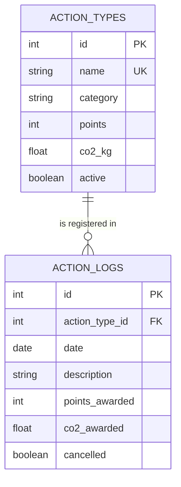

***

# 🍃 GreenPoints · Backend

> Proyecto colaborativo para el desarrollo web de GreenPoints, una aplicación pensada para registrar acciones sostenibles que te permite cuantificar tu impacto ambiental positivo (mediante puntos obtenidos a través del cálculo de CO₂ ahorrado).

---

## 📑 Índice

1. [Descripción](#-descripción)
2. [Aspectos clave](#-aspectos-clave)
3. [Stack tecnológico](#-stack-tecnológico)
4. [Estructura del proyecto](#-estructura-del-proyecto)
5. [Requisitos previos](#-requisitos-previos)
6. [Instalación](#-instalación)
7. [Configuración](#-configuración)
8. [Ejecución](#-ejecución)
9. [Endpoints de la API](#-endpoints-de-la-api)
10. [Modelo de datos (DER)](#-modelo-de-datos-der)
11. [Tests](#-tests)
12. [Organización del trabajo](#-organización-del-trabajo)
13. [Flujo de trabajo con Git](#-flujo-de-trabajo-con-git)
14. [Uso de herramientas de IA](#-uso-de-herramientas-de-ia)
15. [Licencia](#-licencia)

---

## 📖 Descripción

El backend de **GreenPoints** expone una API REST para registrar acciones sostenibles, consultar el catálogo de acciones, calcular los puntos y niveles del usuario y mostrar el impacto ambiental (CO₂ ahorrado) mediante un dashboard y un historial auditable.

Arquitectura en capas:

```
routes (HTTP) → controller (lógica de negocio) → models (persistencia)
                             ↘ schemas (validación)
```

---

## ✨ Aspectos Clave

*   **📊 Dashboard de impacto:** resumen en tiempo de KPIs —puntos totales, CO₂ ahorrado y acciones registradas— con lista de las acciones más recientes.
*   **🗂️ Catálogo de acciones:** grid de acciones sostenibles con búsqueda y filtrado por categoría, cada tarjeta codificada por color (Movilidad, Naturaleza, Reciclaje, Participación).
*   **✅ Registro de acciones:** alta rápida desde el catálogo o mediante un modal dedicado; cada acción guarda fecha, categoría y puntos/CO₂ asociados.
*   **📜 Historial paginado:** tabla de acciones registradas con paginación (15 por página), iconografía por categoría y acciones de editar/eliminar.
*   **🌱 Cálculo de impacto:** los puntos se derivan del CO₂ ahorrado según el tipo de acción.
*   **⚡ SPA sin recargar:** Hash Router propio que inyecta vistas parciales y mantiene la experiencia fluida.
*   **🔔 Secciones sincronizadas:** un mismo registro se refleja en dashboard e historial en vivo mediante eventos (`action:created` / `action:deleted`), sin refrescar la página.
*   **🎨 UI ligera y sin dependencias:** Vanilla JS + CSS tradicional e iconografía Material Symbols; sin framework ni bundler.
*   **🔌 API REST:** consumo del backend con `fetch` nativo, con estados de carga/error y estados vacíos en cada vista.

---

## 🛠️ Stack tecnológico

| Capa | Tecnología |
| --- | --- |
| Lenguaje | Python 3.9+ (probado en 3.14) |
| Framework web | FastAPI |
| Servidor ASGI | Uvicorn |
| ORM | SQLAlchemy 2.0 (`DeclarativeBase`, `Mapped`, `mapped_column`) |
| Validación | Pydantic v2 |
| Base de datos | SQLite (`app/database/greenpoints.db`) |
| Testing | pytest + FastAPI `TestClient` + httpx |
| Frontend | Vanilla JS + CSS + Material Symbols (sin framework ni bundler) |

---

## 📂 Estructura del proyecto

```
backend/
├── app/
│   ├── main.py                  # App FastAPI, CORS, lifespan (init_db + seed)
│   ├── seed.py                  # Catálogo inicial idempotente
│   ├── controller/              # Lógica de negocio
│   │   ├── action_controller.py
│   │   ├── catalog_controller.py
│   │   ├── dashboard_controller.py
│   │   ├── history_controller.py
│   │   └── points_controller.py
│   ├── core/
│   │   ├── config.py            # Settings (Pydantic Settings)
│   │   └── levels.py            # Umbrales y progreso de nivel
│   ├── database/
│   │   └── database.py          # Engine, sesión, Base, init_db
│   ├── models/
│   │   └── action_type_model.py # ActionType y ActionLog
│   ├── routes/                  # Endpoints (capa HTTP)
│   │   ├── actions.py
│   │   ├── catalog.py
│   │   ├── dashboard.py
│   │   ├── history.py
│   │   └── points.py
│   └── schemas/
│       ├── catalog.py
│       └── schemas.py
├── tests/
│   ├── test_catalog.py
│   ├── test_dashboard.py
│   ├── test_history.py
│   ├── test_main.py
│   └── test_points.py
├── requirements.txt
└── README.md
```

> `app/database/greenpoints.db` se genera automáticamente y **no** se versiona (está en `.gitignore`).

---

## 📋 Requisitos previos

- **Python** 3.9 o superior (recomendado 3.11+)
- **Git** para el control de versiones
- Un navegador web moderno (para el frontend y `/docs`)

---

## ⚙️ Instalación

### 1. Clonar y sincronizar
```bash
git clone <URL_DEL_REPOSITORIO>
cd backend
git checkout dev
git pull origin dev
```

### 2. Crear y activar un entorno virtual
```bash
# En macOS / Linux
python3 -m venv venv
source venv/bin/activate

# En Windows (CMD / PowerShell)
python -m venv venv
venv\Scripts\activate
```

### 3. Instalar las dependencias
```bash
pip install -r requirements.txt

# Si necesitas instalar las dependencias principales directamente:
pip install fastapi uvicorn sqlalchemy pydantic pytest httpx
```

---

## 🔧 Configuración

La configuración centralizada está en `app/core/config.py` mediante **Pydantic Settings**, que permite leer variables de entorno o un archivo `.env`:

| Variable | Descripción | Valor por defecto |
| --- | --- | --- |
| `APP_NAME` | Nombre de la aplicación | `GreenPoints` |
| `DATABASE_URL` | URL de conexión a la base de datos | `sqlite:///./app/database/greenpoints.db` |

```bash
cp .env.example .env   # y edita los valores si es necesario
```

> Nota: si usas `app/core/config.py` necesitas instalar `pydantic-settings` (`pip install pydantic-settings`) y añadirlo a `requirements.txt`.

---

## ▶️ Ejecución

### Backend
```bash
uvicorn app.main:app --reload --reload-dir app --host 127.0.0.1 --port 8000
```

- API: http://127.0.0.1:8000
- Swagger UI: http://127.0.0.1:8000/docs
- ReDoc: http://127.0.0.1:8000/redoc

Al arrancar, el `lifespan` crea las tablas y siembra el catálogo automáticamente.

### Frontend
```bash
# Desde la raíz o desde el directorio frontend
python3 -m http.server 5500
```
Abre http://127.0.0.1:5500 en el navegador.

### Tests
```bash
pytest tests/ -v
```

---

## 🔌 Endpoints de la API

| Método | Ruta | Descripción | Tag |
| --- | --- | --- | --- |
| `GET` | `/health` | Comprueba el estado del servicio y la conexión a la BD | Salud |
| `GET` | `/catalog` | Lista el catálogo (`?active=true\|false`) | Catálogo |
| `PUT` | `/catalog/{action_type_id}` | Edita una acción del catálogo | Catálogo |
| `POST` | `/actions/` | Registra una acción sostenible | Registro de acciones |
| `GET` | `/dashboard` | KPIs: puntos, CO₂, nº de acciones y progreso de nivel | Panel |
| `GET` | `/history` | Historial con filtros y paginación | Historial |
| `PUT` | `/history/{action_id}` | Edita un registro del historial | Historial |
| `DELETE` | `/history/{action_id}` | Anula un registro (borrado lógico) | Historial |
| `POST` | `/history/{action_id}/annul` | Anula un registro | Historial |
| `PATCH` | `/history/{action_id}/annul` | Anula un registro (alias) | Historial |
| `POST` | `/user/{user_id}/points` | Puntos y nivel actuales del usuario | Puntos |
| `GET` | `/user/{user_id}/points` | Puntos, nivel, siguiente nivel y progreso | Puntos |

### Filtros de `GET /history`

| Parámetro | Tipo | Descripción |
| --- | --- | --- |
| `start_date` | `date` | Fecha mínima (incluida) |
| `end_date` | `date` | Fecha máxima (incluida) |
| `category` | `string` | Categoría exacta |
| `action_type_id` | `int` | Tipo de acción |
| `min_points` | `int` | Puntos mínimos |
| `include_cancelled` | `bool` | Incluir anuladas (por defecto `true`) |
| `order` | `asc\|desc` | Orden por fecha (por defecto `desc`) |
| `limit` | `int` | Tamaño de página (1–10000, por defecto 1000) |
| `offset` | `int` | Desplazamiento |

### Ejemplo de respuesta — `GET /catalog`
```json
[
  {
    "id": 1,
    "name": "Ir andando al trabajo",
    "category": "Movilidad",
    "points": 10,
    "co2_kg": 2.0,
    "active": true
  }
]
```

---

## 🗄️ Modelo de datos (DER)

Base de datos **SQLite** con **2 tablas físicas** y **2 entidades lógicas** no persistidas (`USER`, `LEVEL`).



### `action_types` (catálogo)
| Campo | Tipo | Nulo | Clave | Descripción |
| --- | --- | --- | --- | --- |
| `id` | INTEGER | No | PK | Identificador |
| `name` | VARCHAR(100) | No | UK | Nombre único |
| `category` | VARCHAR(50) | No | — | Movilidad / Reciclaje / Naturaleza / Participación |
| `points` | INTEGER | No | — | Puntos por registro |
| `co2_kg` | FLOAT | No | — | Kg de CO₂ evitados |
| `active` | BOOLEAN | No | — | Baja lógica (`true` por defecto) |

### `action_logs` (historial)
| Campo | Tipo | Nulo | Clave | Descripción |
| --- | --- | --- | --- | --- |
| `id` | INTEGER | No | PK | Identificador |
| `action_type_id` | INTEGER | No | FK → `action_types.id` | Tipo de acción |
| `date` | DATE | No | — | Fecha (no futura); expuesta como `action_date` |
| `description` | VARCHAR(255) | Sí | — | Comentario libre |
| `category` | VARCHAR(50) | No | — | **Copia** de la categoría en el momento del registro |
| `points_awarded` | INTEGER | No | — | **Copia** de los puntos en el momento del registro |
| `co2_awarded` | FLOAT | No | — | **Copia** del CO₂ en el momento del registro |
| `cancelled` | BOOLEAN | No | — | Borrado lógico / anulación |

> `action_logs` guarda **snapshots** de `category`, `points` y `co2`: editar el catálogo no reescribe el historial.

### Niveles (calculados, sin tabla)
| Nivel | Mínimo (incl.) | Máximo (excl.) |
| --- | --- | --- |
| Seed | 0 | 100 |
| Sprout | 100 | 300 |
| Tree | 300 | 700 |
| Forest | 700 | 1500 |
| Planet Hero | 1500 | ∞ |

📄 Documentación completa del DER: [`docs/DER.md`](docs/DER.md)

---

## 🧪 Tests

```bash
pytest tests/ -v
```

| Archivo | Tests | Qué cubre |
| --- | --- | --- |
| `test_main.py` | 2 | `/health` y 404 de la raíz |
| `test_catalog.py` | 5 | Catálogo y edición de acciones |
| `test_dashboard.py` | 11 | Agregados y umbrales de nivel |
| `test_history.py` | 11 | Filtros, snapshots, edición y anulación |
| `test_points.py` | 4 | Puntos y niveles |
| **Total** | **33** | |

Cada test usa una base de datos SQLite temporal y aislada (`tmp_path` + `override_get_db`), por lo que nunca toca los datos de desarrollo.

> Si `pytest tests/ -v` falla con `ModuleNotFoundError: No module named 'app'`, crea un `pytest.ini` en la raíz:
> ```ini
> [pytest]
> pythonpath = .
> testpaths = tests
> ```

---

## 👥 Organización del trabajo

### Equipo y roles

* **Scrum Master**: Alba (Desarrollador 1 · Dev 1) -> [albavalentinn](https://github.com/albavalentinn)
* **Product Owner**: Naomi (Desarrollador 2 · Dev 2) -> [naomitudic](https://github.com/naomitudic)
* **Colaboradores**:
    * Juliana (Desarrollador 3 · Dev 3) -> [julibarguen98-ib](https://github.com/julibarguen98-ib),
    * Renata (Desarrollador 4 · Dev 4) -> [natyybeky2017-netizen](https://github.com/natyybeky2017-netizen),
    * Ainara (Desarrollador 5 · Dev 5) -> [ainaragrcgrc-coder](https://github.com/ainaragrcgrc-coder),

| Miembro | Rol | Responsabilidad principal |
| --- | --- | --- |
| Dev 1 | Backend / Base de datos | Estructura inicial, BD, catálogo, registro de acciones y revisión final |
| Dev 2 | Backend / Datos | Esquemas y módulo de historial (lógica + tests + snapshots) |
| Dev 3 | Backend / Configuración y puntos | Configuración, API de puntos y niveles, tests de puntos, documentación |
| Dev 4 | Backend / Dashboard | Estructura de carpetas, dashboard, lógica de impacto y tests |
| Dev 5 | Backend / Núcleo | `main.py`, health-check y tests de integración |

### Reparto de trabajo por desarrollador

| Dev | Área | Ramas principales | Entregables |
| --- | --- | --- | --- |
| Dev 1 | Base de datos · Catálogo · Registro | `feature/dev1-database-setup`, `feature/dev1-api-catalog`, `feature/dev1-backend-registration-logic`, `feature/dev1-backend-tests`, `feature/dev1-final-review` | Esquema inicial, `GET /catalog`, `POST /actions`, tests base, README |
| Dev 2 | Esquemas · Historial | `feature/dev2-backend-schemas`, `feature/dev2-pi-history`, `feature/dev2-backend-history-logic`, `feature/dev2-backend-history-tests`, `fix/history-category-join` | `GET /history`, filtros, snapshots de categoría, tests de historial |
| Dev 3 | Configuración · Puntos y niveles | `feature/dev3-backend-config`, `feature/dev3-api-points-levels`, `feature/dev3-backend-points-tests`, `feature/dev3-docs-setup` | `Settings`, `/user/{id}/points`, progresión de nivel, tests y docs |
| Dev 4 | Estructura · Dashboard · Impacto | `feature/dev4-backend-structure`, `feature/dev4-api-dashboard`, `feature/dev4-backend-impact-logic`, `feature/dev4-backend-dashboard-tests` | Reorganización en capas, `GET /dashboard`, cálculo de CO₂, tests |
| Dev 5 | Núcleo · Salud | `feature/dev5-backend-main`, `feature/dev5-backend-health-tests` | `app/main.py`, `GET /health`, tests de integración |

### Hitos del proyecto

| # | Hito | Contenido | Estado |
| --- | --- | --- | --- |
| 1 | Estructura y base de datos | Modelos, `database.py`, `seed.py` | ✅ Completado |
| 2 | Catálogo y registro | `GET /catalog`, `POST /actions/` | ✅ Completado |
| 3 | Puntos y niveles | `/user/{id}/points`, `core/levels.py` | ✅ Completado |
| 4 | Dashboard e impacto | `GET /dashboard`, agregados de CO₂ | ✅ Completado |
| 5 | Historial y auditoría | Filtros, edición y anulación | ✅ Completado |
| 6 | Pruebas y documentación | Suite de tests, README y DER | ✅ Completado |

### Convención de nombres de rama

| Prefijo | Uso | Ejemplo |
| --- | --- | --- |
| `main` | Versión estable | `main` |
| `dev` | Integración | `dev` |
| `feature/devN-...` | Nueva funcionalidad | `feature/dev2-backend-history-logic` |
| `fix/...` | Corrección de errores | `fix/history-category-join` |
| `refactor/...` | Refactor sin cambio funcional | `refactor/dev1-remove-duplicate-route` |
| `revert/...` | Reversión de cambios | `revert-72-dev` |

### Convención de commits

| Prefijo | Uso |
| --- | --- |
| `feat:` | Nueva funcionalidad |
| `fix:` | Corrección de errores |
| `refactor:` | Refactorización sin cambio de comportamiento |
| `test:` | Añadir o corregir tests |
| `docs:` | Documentación |
| `chore:` | Tareas de mantenimiento |
| `revert:` | Reversión |

---

## 🌿 Flujo de trabajo con Git

1. Actualiza la rama de integración:
   ```bash
   git checkout dev
   git pull origin dev
   ```
2. Crea una rama para tu tarea:
   ```bash
   git checkout -b feature/devN-mi-funcionalidad
   ```
3. Desarrolla y ejecuta los tests:
   ```bash
   pytest tests/ -v
   ```
4. Haz commits siguiendo la convención:
   ```bash
   git add .
   git commit -m "feat: descripción breve del cambio"
   ```
5. Sube la rama:
   ```bash
   git push -u origin feature/devN-mi-funcionalidad
   ```
6. Abre un **Pull Request** hacia `dev`, solicita revisión y resuelve comentarios.
7. Tras el merge, elimina la rama.

**Reglas**
- No se hace push directo a `main` ni a `dev`.
- Todo cambio entra por Pull Request revisado por otro miembro.
- Un PR debe pasar los tests antes de fusionarse.

---

## 🤖 Uso de herramientas de IA y metodología

### Propósito

Las herramientas de Inteligencia Artificial se utilizaron como apoyo durante el desarrollo de GreenPoints para ayudar a comprender conceptos técnicos, resolver problemas de programación y mejorar la documentación del proyecto.

### Cómo se utilizaron

- **Orientación técnica:** conceptos de Python, FastAPI, Git y pruebas de software.
- **Resolución de problemas:** investigación de errores y exploración de soluciones.
- **Documentación:** organización de la información técnica y claridad de la documentación.
- **Revisión de código:** sugerencias usadas como referencia para posibles mejoras.

### Validación y responsabilidad

Las respuestas generadas por IA fueron revisadas y adaptadas a los requisitos del proyecto. Las soluciones sugeridas se prueban antes de integrarse. El equipo de desarrollo sigue siendo responsable de la implementación final, las decisiones técnicas y la verificación del funcionamiento.

### Uso responsable

- Las herramientas de IA son un apoyo para el aprendizaje, no un sustituto de entender el código.
- Las sugerencias se revisan antes de aplicarse.
- Los requisitos del proyecto y las convenciones de código tienen prioridad.
- No se comparte información sensible (contraseñas, claves de API, credenciales).

***


